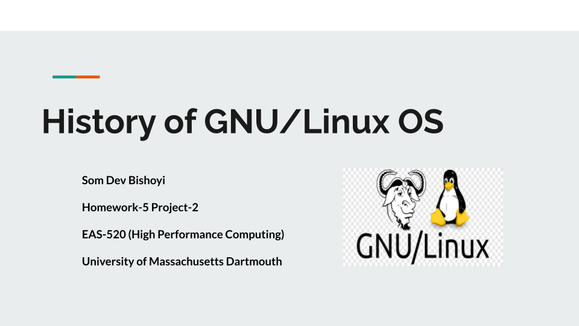

EAS/DSC 520 - High-Performance Scientific Computing
======

Material included concepts such as version control(Git), programming in C, running HPC jobs 
through SLURM, parallel programming in C and python.

Presentation from when I took this course (Spring 2023)
------

*History of GNU/Linux OS* — click the slide to open the full deck.
